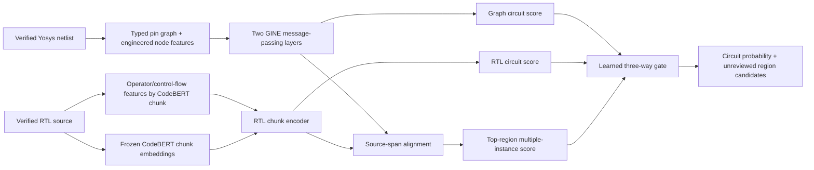

# Typed graph and source-aligned RTL fusion (development experiment)

This experiment leaves the existing pipeline and saved baseline artifacts intact. It uses the 42 AES/RS232 development circuits and the 10 memctrl/PIC diagnostic circuits already present under `runs/`. All three development folds and both external hosts have been inspected during earlier analysis, so the resulting scores are **development diagnostics**, not a blind generalization estimate.

## Data path

1. Read each saved Yosys JSON, graph tensor, source map, and frozen CodeBERT embedding. Verify all saved source and artifact hashes.
2. Retain the original ordered cells. Add primary-input, real-output, and constant boundary nodes. Add directed, pin-typed connections in both directions for message passing.
3. Compute 16 RTL operator/control-flow frequencies per saved CodeBERT chunk. These frequencies ignore comments and identifier spelling; they are not a full Verilog AST and may conflate some operators (for example, `<=`).
4. Join cell source ranges to RTL chunk line ranges. Each cell links to its three strongest overlapping chunks. Unmatched chunks receive the global graph representation in the fusion model.
5. Train a two-layer GINE encoder, frozen-CodeBERT-plus-structural RTL encoder, sparse source-aligned region head, and a three-way gated logit. Graph-only, RTL-only, and structured-RTL-only arms use the same data splits and optimizer.

The region probabilities are weakly supervised circuit-label candidates. No ground-truth gate or line labels exist in this dataset, so these are **not** validated Trojan localizations. No generative LLM is used in detection; a separate language model may later explain reviewed evidence.



## Commands

Use the project virtual environment from the repository root:

```powershell
& .\trusthub\venv\Scripts\python.exe -m unittest discover -s experiments/typed_fusion_v1 -p test_pipeline.py -v
& .\trusthub\venv\Scripts\python.exe experiments/typed_fusion_v1/prepare.py
& .\trusthub\venv\Scripts\python.exe experiments/typed_fusion_v1/verify.py
& .\trusthub\venv\Scripts\python.exe experiments/typed_fusion_v1/train.py --arm fusion --setting all --epochs 25 --seed 42
& .\trusthub\venv\Scripts\python.exe experiments/typed_fusion_v1/calibrate.py runs/typed_fusion_v1/training/fusion_all_25ep_seed42
```

Repeat the last command with `graph`, `rtl`, and `structured` arms for a matched ablation. `--setting cv` runs the three development folds; `external` trains on all development circuits and evaluates memctrl/PIC. A fixed threshold of 0.5 is used for diagnostic classification; AUROC and paired clean/Trojan ranking avoid threshold tuning on inspected hosts.

For input-group importance, repeat a matched run with `--ablate rtl_struct`, `--ablate graph_handcrafted`, or `--ablate alignment`. Each starts from the same seed and removes the specified input before training. These are small-data sensitivity checks, not causal feature attribution.

Outputs are written to `runs/typed_fusion_v1/`. In particular, `verification.json` documents reconstruction checks; each training directory contains its protocol, checkpoints, predictions, and summary.

`calibrate.py` chooses a threshold from each fold's training outputs only and writes a separate `calibration.json`. It does not modify the fixed-threshold predictions or tune on held-out data.

## Interpretation limits

- The dataset has only three distinct clean source families/templates across the 21 development pairs. Pairs within a template share substantial code and structure; effective diversity is much smaller than 42 circuits.
- AES variants in one fold also have a top-port difference correlated with the Trojan label. A graph model can exploit that shortcut. Probe port ablations or repair the data before treating scores as evidence of functional detection.
- CodeBERT is a frozen generic code model. Its embeddings may carry identifier and formatting cues that the handcrafted RTL branch deliberately avoids.
- The heuristic RTL operator features are a fast first version. They lack full syntax or dataflow semantics and need a parser-based successor for definitive feature evaluation.
- The external memctrl/PIC diagnostic has only two hosts, was previously inspected, and provides no confidence interval for deployment to unseen designs.
